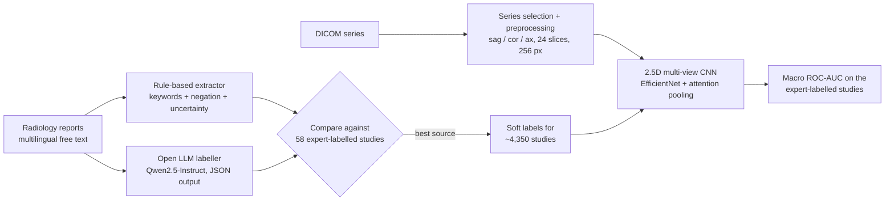

# Knee MRI abnormality detection from weakly-labelled radiology reports

[](https://colab.research.google.com/github/vahid-karami/rsna-knee-mri/blob/main/notebooks/rsna_knee_colab.ipynb)

This is a deep-learning pipeline for the
[RSNA Knee Abnormality Detection](https://www.kaggle.com/competitions/rsna-knee-abnormality-detection) challenge (Kaggle, 2026).
It detects **12 clinically important findings** on knee MRI:

| Ligaments | Menisci | Osteoarthritis | Joint | Bone |
|---|---|---|---|---|
| ACL tear, MCL tear | medial / lateral meniscal tear | medial, lateral, patellofemoral | effusion, synovitis, Baker's cyst | contusion, fracture |

## The problem: lots of images, almost no labels

The training set has ~4,400 MRI studies (~24,000 series, ~800,000 DICOM slices) from about 19 hospitals.
**Only 58 studies carry expert labels.** Every study, however, comes with its free-text radiology report, written in roughly 9 languages.
This project treats the reports as a source of *weak supervision*:



1. **Report labelling** ([`report_rules.py`](src/knee/report_rules.py), [`report_llm.py`](src/knee/report_llm.py)):
   - A transparent rule-based extractor covers 7 languages. It handles negation ("no effusion", "kein Erguss", "geen vocht"), uncertainty ("possible tear") and laterality (medial vs lateral meniscus), and gives priority to the *Impression* section.
   - An open-weight LLM (Qwen2.5-3B/7B-Instruct, small enough for a free Colab T4) reads each report and returns a JSON object with the 12 findings.
   - Both are scored against the expert labels, and the better source (or their average) becomes the training target ([`build_labels.py`](src/knee/build_labels.py)).
2. **Preprocessing** ([`preprocess.py`](src/knee/preprocess.py)): picks one fluid-sensitive series per plane (sagittal, coronal, axial) from the series metadata, orders slices by their 3D position, inverts MONOCHROME1 images, windows each series to its 1st-99th percentile, and resamples to 24 × 256 × 256.
3. **Model** ([`model.py`](src/knee/model.py)): a 2.5D design. Each slice is stacked with its two neighbours as a 3-channel image and encoded by an ImageNet-pretrained CNN that is shared across slices and views. Attention pooling summarises each view, the three views are concatenated (missing views are masked), and a linear head outputs 12 logits. The model is trained with BCE on soft labels using AdamW, a one-cycle schedule and mixed precision ([`train_image.py`](src/knee/train_image.py)).
4. **Evaluation**: the competition metric, macro ROC-AUC over the 12 findings. The expert-labelled studies are **never used for training or for picking the checkpoint**, so their score is an unbiased estimate. The checkpoint is chosen on a held-out 15% of report-labelled studies.

## Results

> 🚧 Experiments are running. Results will be added here.

| Stage | Macro ROC-AUC (expert-labelled studies) |
|---|---|
| Report labels: rules | in progress |
| Report labels: LLM | in progress |
| Image model (EfficientNet-B0, 1,500 studies) | in progress |

<!-- After training: copy results.png from Google Drive (rsna-knee/work/) into docs/ and uncomment:

-->

Numbers come from `work/labels/label_agreement.csv` and `work/models/results.json`.

## Run it

**Google Colab (recommended).** Open [`notebooks/rsna_knee_colab.ipynb`](notebooks/rsna_knee_colab.ipynb) with the badge above and select a T4 GPU.
The notebook downloads the report tables with the Kaggle API, runs both labellers and trains the image model.

The full image set (~250 GB) does not fit on a Colab disk. It is preprocessed once inside a free Kaggle notebook, where the data is already mounted,
using [`notebooks/kaggle_preprocess.ipynb`](notebooks/kaggle_preprocess.ipynb). That produces a ~4 GB cache of 1,500 studies, which Colab then downloads.

**Command line** (Kaggle, Colab or a local GPU):

```bash
pip install -r requirements.txt
cd src
python -m knee.build_labels                  # rule-based labels + agreement with experts
python -m knee.report_llm --batch-size 16    # LLM labels (resumable)
python -m knee.build_labels                  # pick the best label source
python -m knee.preprocess --max-studies 1500 # DICOM -> npz cache (where the data lives)
python -m knee.train_image --epochs 10
python -m knee.predict --checkpoints ../work/models/best.pt   # submission.csv
```

Paths are set with the `KNEE_DATA_ROOT`, `KNEE_WORK_DIR` and `KNEE_CACHE_DIR` environment variables.

**Tests** run without the competition data:

```bash
pytest                       # report-labeller unit tests (multilingual, negation, laterality)
python tests/smoke_test.py   # end-to-end run on fake DICOMs, CPU, ~1 min
```

## Repository layout

```
src/knee/
  config.py         paths, label names
  data.py           tables, gold subset, series selection per view
  report_rules.py   multilingual rule-based report labeller
  report_llm.py     LLM report labeller (Hugging Face transformers)
  build_labels.py   compare label sources against experts, write targets.csv
  preprocess.py     DICOM -> normalised uint8 volumes
  model.py          2.5D multi-view CNN with attention pooling
  train_image.py    training + honest evaluation
  metrics.py        macro ROC-AUC
  predict.py        submission.csv for the test set
notebooks/          Colab pipeline, Kaggle preprocessing
tests/              unit tests + synthetic end-to-end smoke test
```

## Limitations

- 58 expert-labelled studies is a small validation set, and some findings have only a few positives there, so per-finding AUCs are noisy.
- Report-derived labels describe what the radiologist *wrote*, which is not always what the images show.
- Horizontal flips are deliberately not used as augmentation, because they could swap medial and lateral anatomy.
- Training uses a 1,500-study subset so it fits Colab's free tier. Using all studies and an ensemble of models should improve results.

## Acknowledgements

Data: Radiological Society of North America (RSNA) and the challenge's contributing institutions, via Kaggle.
The data is subject to the competition rules and is **not** included in this repository.
This is a research and portfolio project, not a medical device.

License: MIT (code only).
